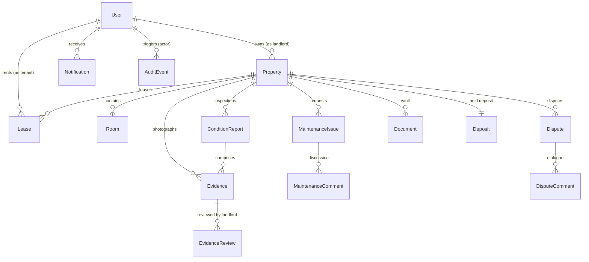

# RentGuard Database Design & Mongoose Schemas

RentGuard uses MongoDB as its primary persistence engine, managed through Mongoose ODM. All relationships are modeled with ObjectId references to maintain referential integrity while keeping queries performant.

---

## 1. Entity-Relationship Overview

---

## 2. Detailed Collection Schemas

### 2.1 Users (`users`)
Stores tenant, landlord, and administrator credentials and profile data. Passwords are encrypted using salted bcrypt hashing.
* `_id`: ObjectId (Primary Key)
* `name`: String (Required, trimmed)
* `email`: String (Required, unique, lowercase, indexed)
* `phone`: String (Optional)
* `passwordHash`: String (Required, bcrypt salted hash)
* `role`: String (`'tenant' | 'landlord' | 'admin'`, default: `'tenant'`, indexed)
* `avatar`: String (Optional URL)
* `isEmailVerified`: Boolean (default: `false`)
* `isActive`: Boolean (default: `true`)
* `createdAt`, `updatedAt`: Timestamps

### 2.2 Properties (`properties`)
Stores rental real estate assets assigned to landlords.
* `_id`: ObjectId (Primary Key)
* `name`: String (Property alias / nickname)
* `address`: String (Required street address, indexed)
* `city`, `state`, `postalCode`, `country`: Geographic metadata
* `propertyType`: String (`'2BHK Apartment'`, `'1BHK Studio'`, `'Independent House'`, etc.)
* `floor`: String
* `description`: String
* `coverImage`: String (URL)
* `images`: Array of Strings
* `ownerId`: ObjectId ref `User` (Landlord, indexed)
* `managerIds`: Array of ObjectIds ref `User`
* `status`: String (`'active' | 'vacant' | 'maintenance' | 'archived'`, indexed)
* `monthlyRent`: Number (Default monthly rate in INR)
* `deposit`: Number (Total security deposit amount in INR)
* `createdAt`, `updatedAt`: Timestamps

### 2.3 Leases (`leases`)
Stores historical and active tenancy contracts connecting a property, tenant, and landlord.
* `_id`: ObjectId (Primary Key)
* `propertyId`: ObjectId ref `Property` (Indexed)
* `tenantId`: ObjectId ref `User` (Indexed)
* `landlordId`: ObjectId ref `User` (Indexed)
* `startDate`: Date (Contract start)
* `endDate`: Date (Contract termination / renewal)
* `monthlyRent`: Number (Rent agreed for this lease cycle)
* `securityDeposit`: Number (Security deposit paid for this lease)
* `currency`: String (Default: `'INR'`)
* `status`: String (`'pending' | 'active' | 'completed' | 'terminated'`, indexed)
* `agreementDocumentId`: ObjectId ref `Document` (Optional)
* `createdAt`, `updatedAt`: Timestamps

### 2.4 Rooms (`rooms`)
Represents distinct physical inspection areas within a property.
* `_id`: ObjectId (Primary Key)
* `propertyId`: ObjectId ref `Property` (Indexed)
* `name`: String (`'Living Room'`, `'Master Bedroom'`, `'Kitchen'`, `'Bathroom'`, `'Balcony'`)
* `roomType`: String (`'living_room' | 'bedroom' | 'kitchen' | 'bathroom' | 'balcony' | 'hallway' | 'other'`)
* `order`: Number (Display sequence)
* `description`: String

### 2.5 Condition Reports (`condition_reports`)
Formal handover inspection documents (Move-In or Move-Out).
* `_id`: ObjectId (Primary Key)
* `propertyId`: ObjectId ref `Property` (Indexed)
* `leaseId`: ObjectId ref `Lease` (Indexed)
* `submittedBy`: ObjectId ref `User`
* `reportType`: String (`'MOVE_IN' | 'MOVE_OUT'`)
* `status`: String (`'DRAFT' | 'SUBMITTED' | 'UNDER_REVIEW' | 'REVIEWED' | 'CONFIRMED'`)
* `summary`: String (Overview / AI-assisted summary)
* `submittedAt`: Date
* `reviewedAt`: Date
* `reviewedBy`: ObjectId ref `User` (Landlord)

### 2.6 Evidence (`evidences`)
Granular room-and-component condition records accompanied by photograph URLs.
* `_id`: ObjectId (Primary Key)
* `propertyId`: ObjectId ref `Property` (Indexed)
* `leaseId`: ObjectId ref `Lease`
* `reportId`: ObjectId ref `ConditionReport`
* `roomId`: ObjectId ref `Room` (Indexed)
* `type`: String (`'move-in' | 'move-out'`)
* `component`: String (`'walls' | 'ceiling' | 'flooring' | 'doors' | 'windows' | 'electrical' | 'plumbing' | 'general'`)
* `condition`: String (`'excellent' | 'good' | 'fair' | 'poor' | 'damaged'`)
* `notes`: String
* `photos`: Array of `{ url: String, caption: String, takenAt: Date, uploadedBy: ObjectId }`
* `confirmationStatus`: String (`'pending' | 'confirmed' | 'flagged' | 'rejected'`, indexed)
* `createdBy`: ObjectId ref `User`

### 2.7 Evidence Reviews (`evidence_reviews`)
Immutable audit record of landlord actions on submitted evidence.
* `_id`: ObjectId (Primary Key)
* `evidenceId`: ObjectId ref `Evidence` (Indexed)
* `reviewerId`: ObjectId ref `User`
* `decision`: String (`'CONFIRMED' | 'FLAGGED'`)
* `reason`: String (Mandatory when flagged)
* `createdAt`: Date

### 2.8 Maintenance Issues (`maintenance_issues`)
Tenant repair and maintenance tickets.
* `_id`: ObjectId (Primary Key)
* `propertyId`: ObjectId ref `Property` (Indexed)
* `leaseId`: ObjectId ref `Lease`
* `roomId`: ObjectId ref `Room`
* `createdBy`: ObjectId ref `User` (Tenant, indexed)
* `assignedTo`: String (e.g. `'Plumber'`, `'Electrician'`)
* `title`: String (Required)
* `description`: String
* `category`: String (`'plumbing' | 'electrical' | 'structural' | 'appliances' | 'cleaning' | 'pest' | 'general'`)
* `priority`: String (`'low' | 'medium' | 'high' | 'urgent'`)
* `status`: String (`'open' | 'in_progress' | 'resolved' | 'closed'`, indexed)
* `attachments`: Array of Strings (File URLs)
* `resolutionNotes`: String
* `reportedAt`, `resolvedAt`: Dates

### 2.9 Maintenance Comments (`maintenance_comments`)
Discussion thread per maintenance ticket.
* `_id`: ObjectId (Primary Key)
* `issueId`: ObjectId ref `MaintenanceIssue` (Indexed)
* `userId`: ObjectId ref `User`
* `userName`: String
* `text`: String
* `attachments`: Array of Strings
* `createdAt`: Date

### 2.10 Disputes (`disputes`)
Formal claims raised regarding security deposits, damages, or repair liabilities.
* `_id`: ObjectId (Primary Key)
* `propertyId`: ObjectId ref `Property` (Indexed)
* `leaseId`: ObjectId ref `Lease`
* `raisedBy`: ObjectId ref `User` (Indexed)
* `category`: String (`'existing_damage' | 'new_damage' | 'maintenance_responsibility' | 'deposit' | 'other'`)
* `title`: String
* `description`: String
* `amount`: Number (Disputed amount in INR minor/standard units)
* `evidenceIds`: Array of ObjectIds ref `Evidence`
* `status`: String (`'pending' | 'disputed' | 'under_review' | 'resolved' | 'closed'`, indexed)
* `timeline`: Array of `{ event: String, date: Date, userId: ObjectId }`
* `resolutionNotes`: String
* `raisedAt`, `resolvedAt`: Dates

### 2.11 Deposits (`deposits`)
Itemized security deposit account per property tenancy.
* `_id`: ObjectId (Primary Key)
* `propertyId`: ObjectId ref `Property` (Indexed)
* `leaseId`: ObjectId ref `Lease`
* `totalDeposit`: Number (Initial deposit held, e.g. ₹84,000)
* `deductions`: Array of `{ reason: String, amount: Number, status: String, disputeId: ObjectId }`
* `totalDeducted`: Number (Computed sum of deductions)
* `refundAmount`: Number (Computed: totalDeposit - totalDeducted)
* `status`: String (`'held' | 'disputed' | 'settled' | 'refunded'`)

### 2.12 Documents (`documents`)
Encrypted tenancy documents and repair invoices.
* `_id`: ObjectId (Primary Key)
* `propertyId`: ObjectId ref `Property` (Indexed)
* `name`: String
* `type`: String (`'lease' | 'condition_report' | 'receipt' | 'invoice' | 'other'`)
* `url`: String (Permanent file path or cloud URL)
* `fileType`: String (`'pdf' | 'jpg' | 'png' | 'docx'`)
* `size`: String (Human readable, e.g. `'1.2 MB'`)
* `uploadedBy`: ObjectId ref `User`
* `uploadedAt`: Date

### 2.13 Notifications (`notifications`)
In-app alerts dispatched upon lifecycle events.
* `_id`: ObjectId (Primary Key)
* `recipientId`: ObjectId ref `User` (Indexed)
* `type`: String (`'dispute' | 'maintenance' | 'lease' | 'document' | 'inspection' | 'system'`)
* `title`: String
* `body`: String
* `read`: Boolean (Default: `false`, indexed)
* `link`: String (Role-aware client route)
* `createdAt`: Date

### 2.14 Audit Events (`audit_events`)
Append-only tamper-evident event log.
* `_id`: ObjectId (Primary Key)
* `actorId`: ObjectId ref `User` (Indexed)
* `action`: String (e.g. `'USER_LOGIN'`, `'EVIDENCE_UPLOAD'`, `'DISPUTE_RESPOND'`)
* `entityType`: String
* `entityId`: String
* `metadata`: Mixed JSON object
* `ipAddress`: String
* `userAgent`: String
* `createdAt`: Date

